 

---

### `// sobre`

Engenheiro de software com foco em **automação**, **IA aplicada**, **dashboards** e **sistemas end-to-end**. Construo soluções que saem do papel e rodam em produção — da extração de dados à interface final, do backend ao deploy.

> *"Código limpo, reutilizável e que resolve o problema de verdade."*

---

### `// especialidades`

<table>
<tr>
<td width="50%" valign="top">

**Automações**
- RPA e pipelines de dados (Python, requests, pandas)
- Integração com APIs governamentais (Receita Federal, SERPRO)
- Processamento em lote e relatórios automatizados

**IA & Desenvolvimento com IA**
- Assistentes e agentes com LLMs
- Geração e revisão de código assistida por IA
- Classificação e análise de dados com modelos

</td>
<td width="50%" valign="top">

**Dashboards & Sistemas**
- Dashboards analíticos (React, Chart.js, métricas em tempo real)
- Sistemas web full-stack (Flask, FastAPI, Vercel serverless)
- Cofres criptografados, autenticação e segurança de dados

**Stack principal**
- Python · TypeScript · JavaScript · React · Flask · FastAPI
- PostgreSQL · Supabase · SQLite · Vercel · Git/GitHub

</td>
</tr>
</table>

---

### `// projetos em destaque`

| Projeto | Descrição | Stack |
|---|---|---|
| [**Monitor CBS**](https://github.com/DiksonRodrigues/monitor-cbs) | Apuração assistida da CBS integrada à Receita Federal: solicitação, acompanhamento em até 4h, download do retorno, painel e conferência Receita × razão | Flask · HTML/CSS/JS · Vercel · Supabase |
| [**Calculadora RTC**](https://github.com/DiksonRodrigues/automacao-calculadora-rtc) | Automação que processa 500 operações na calculadora oficial da Receita (CBS/IBS/IS), com relatório Excel e memória de cálculo | Python · Java/Spring Boot · SQLite |
| [**UrbanFlow Dashboard**](https://github.com/DiksonRodrigues/urbanflow-dashboard) | Dashboard analítico de mobilidade urbana | React · Chart.js |
| [**Dash Wagner**](https://github.com/DiksonRodrigues/dashWagner) | Dashboard de indicadores | JavaScript |

---

### `// números`

  
  

---

· azul escuro · preto · metálico · especialista ·

